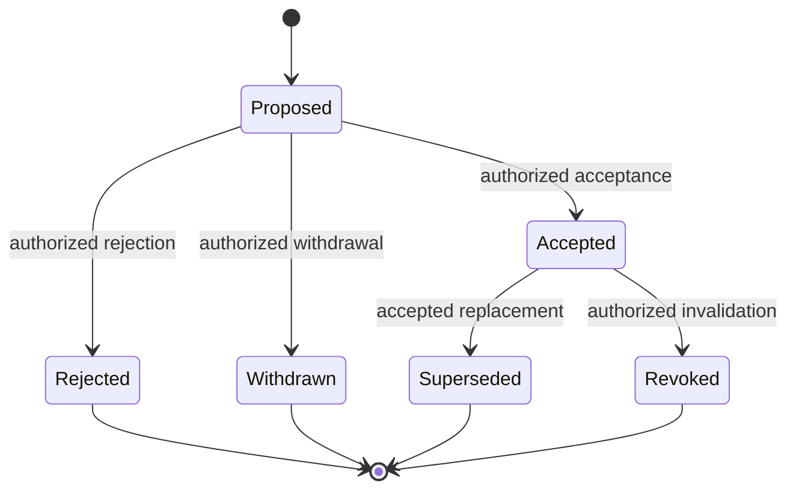

# SF CodeIntel — Architecture Decision Record Governance and Template

| Document control | Value |
|---|---|
| Document ID | SF-CI-ADR-001 |
| Revision | 0.1 |
| Date | 25 November 2026 |
| Status | Proposed — pending independent review and explicit acceptance |
| Intended repository | `sf-codeintel` |
| Intended canonical path | `docs/adr/SF-CI-ADR-001.md` |
| Authority domain | Governance, evidence requirements, acceptance and lifecycle of architecture decision records |
| Decision owner / acceptance authority | To be designated by project governance for each decision scope |
| Implementation or execution authorization | None granted |

> **Index broadly. Retrieve selectively. Verify precisely. Execute securely.**

`SF-CI-ADR-001` identifies this governance document. `ADR-001` identifies the separate backend-selection decision. They are not interchangeable. This document does not select a backend or establish a passing qualification result.

## 1. Purpose and authority

### 1.1 Purpose

Architecture Decision Records (ADRs) make material technical choices explicit, reviewable, reproducible and traceable to the requirements they realize. An ADR records **which option is selected, why, under which constraints, and what consequences follow**. An accepted ADR is binding only within its approved scope, effective revision and applicable higher-level constraints.

The objective is to prevent coding agents from independently reinventing architectural decisions or treating speculative design examples, upstream claims, benchmark output and informal discussion as accepted authority. Governance is intentionally lightweight: Markdown records, immutable revision references, reviewed evidence and explicit acceptance. No workflow engine, database, approval service or runtime registry is authorized by this document.

MUST and MUST NOT describe proposed governance obligations upon acceptance. SHOULD denotes a recommended default; a departure requires recorded rationale when material. Examples and templates do not constitute decisions.

### 1.2 Scoped ownership

| Artifact | Governs | ADR relationship |
|---|---|---|
| SF-CI-PRD-001 | Product purpose, outcomes, requirements, user experience and product acceptance | An ADR realizes product requirements; it cannot amend them. |
| SF-CI-SPEC-001 | System architecture, technical invariants, security boundaries and phase dependencies | An ADR chooses an approach within these constraints; an architecture conflict requires an accepted architecture amendment. |
| SF-CI-ADR-001 (this document) | How ADRs are authored, reviewed, accepted, superseded and revoked | Governs the decision process; does not select an option. |
| Individual accepted ADR | A specific technical decision and its scoped constraints | Governs the selected approach, not unrelated product or technical areas. |
| Phase TDD and technical contracts | Exact implementation interfaces, schemas, state transitions, errors and tests | Elaborate the accepted decision; cannot silently reverse it. |
| SF-CI-P0-001 and subsequent assignments | Admission, permitted operations, resource limits, deliverables and STOP conditions | Authorize qualification or implementation only within their own bounds; ADR acceptance cannot replace admission. |
| Verification evidence and independent review | Observed outcomes, findings and recommendations | Support or challenge a decision; cannot alone make it binding. |

Authority is scoped rather than a universal ordering by document type or recency. All applicable accepted constraints must be satisfied. Where two authorities conflict, stop the affected decision/work, cite exact revisions and clauses, and obtain a reviewed amendment from the relevant authority. Do not choose a rule by timestamp, retrieval score, folder location or agent preference. Unaffected authorized work may continue if it can be separated safely.

### 1.3 Adoption and scope of this revision

This governance proposal aligns with SF-CI-PRD-001 v0.1, SF-CI-SPEC-001 v0.3 and SF-CI-P0-001 v0.3. Those separated revisions are themselves proposed. Until coordinated acceptance of the PRD and architecture, the reviewed combined v0.2.1 architecture remains the baseline; the v0.2.1 P0 assignment remains applicable until separately superseded. Acceptance of this governance document does not change that status or admit P0-A.

This document governs human/agent engineering decision records. Runtime authority ingestion, delivery, invalidation, leases and enforcement in CodeIntel remain governed by the applicable architecture §§10–12 and future phase-specific contracts. No implementation of those mechanisms is part of ADR governance adoption.

## 2. When an ADR is required

Create an ADR for a material choice that changes architectural ownership, security or execution boundaries, compatibility, persistent data contracts, externally visible interfaces, significant dependency selection or long-term operational commitments. Also create one where alternatives carry meaningful trade-offs and future agents need to understand why a choice was made.

| Decision type | Examples | Required treatment |
|---|---|---|
| Structural ownership | Dexter/Dexterity reuse, extension or replacement; one structural owner | ADR and qualification evidence |
| Evidence and storage | Canonical identity, generation binding, schema ownership, retention or duplicated indexes | ADR for the material strategy; TDD for concrete schema |
| Interfaces | MCP transport, versioning and compatibility strategy | ADR for architectural choice; TDD for exact protocol |
| Security and execution | OS containment, project-controlled compilation, trust boundaries | ADR with security review and relevant negative-case evidence |
| Framework intelligence | Static/compiled extraction boundaries and unsupported-version policy | ADR where ownership or trust changes |
| Optimization | Embeddings, overlays, additional caching or distributed services | ADR only when a measured gap justifies the choice |

Routine implementation choices within an accepted TDD, formatting changes, local refactors without contract impact and ordinary test additions do not require an ADR. Record them in the PR or task if useful. A new dependency or new layer is not automatically justified merely because an ADR can be written for it.

Do not open speculative ADRs for every future subsystem. Allocate records just in time, before the affected implementation choice becomes binding. An unresolved ADR may block its dependent implementation, but it must not expand the active task beyond its authorization.

## 3. Roles and approval boundaries

| Role | Responsibility | Boundary |
|---|---|---|
| Proposer (human or agent) | Describe the decision, alternatives, constraints, evidence, risks and recommendation | May propose, not self-accept or grant execution |
| Decision owner | Accountable for the decision scope and its consequences | Must be designated by trusted project governance |
| Independent reviewer | Check exact proposal, authority references, evidence, alternatives and unresolved findings | Independent of the proposal's authorship; recommendation is not execution authorization |
| Security / domain reviewer | Review affected security or domain constraints where required by applicable governance | Cannot waive mandatory constraints without their authorized amendment |
| Authorized acceptance authority | Record accept, reject, withdraw, supersede or revoke decisions within its mandate | Must not be inferred from a repository file or model output |
| Implementer | Follow applicable accepted ADR and TDD within authorized task | Must escalate material deviations before implementing them |

The decision owner may also be the designated acceptance authority if governance explicitly permits it; independent review is still required for acceptance. Roles need not be separate software accounts for a local documentation process, but accountability and review independence must be established. No person, agent or approval identity is appointed by this proposal.

The following are separate gates, not implicit promotions: qualification admission; qualification completion; positive backend recommendation; ADR acceptance; phase implementation admission; PR merge recommendation; release/deployment authorization. For example, accepting ADR-001 after P0 does not authorize P1.

## 4. Record identity, revision and scope

### 4.1 Identity and immutable history

- Assign a stable repository-unique ID such as `ADR-001`. Do not recycle IDs, even after rejection.
- Use a descriptive path such as `docs/adr/ADR-001-backend-selection.md`. The path is a locator, not an identity or approval mechanism.
- Each submitted revision has a unique revision identifier and an immutable content reference (Git object or exact content hash). Draft iterations may be edited before submission; once reviewed, any substantive or editorial content change creates a new proposal revision and requires the applicable review.
- Preserve prior reviewed and accepted revisions and their decision events. Do not rewrite an accepted record to make an alternative appear to have been selected historically.
- Record approval against the exact proposal bytes or immutable Git object in a separate trusted decision/approval record. A status field or a mutable Markdown file cannot establish its own acceptance. Avoid circular hashing of an approval record that contains the digest of itself.

The canonical path may point to the currently applicable record for human navigation; authoritative retrieval must establish the actual accepted revision and scope. Git history is an audit reference, not proof that every committed document was approved.

### 4.2 Scope and applicability

Every ADR MUST identify the affected component, repository/system boundary, phase or release applicability, governed decision key, explicit exclusions, prerequisite decisions and effective/supersession conditions. Include relevant versions where the decision is version-bound.

A decision key is a stable label for the architectural question, e.g. `structural_backend_ownership`. It aids conflict detection; it is not a new product requirement or an authorization grant. Multiple decisions may coexist if their scopes are disjoint or expressly compatible. Overlapping contradictory active choices for the same scope MUST NOT be accepted. Uncertain applicability is an unresolved authority condition, not permission to select the most convenient record.

Record references to applicable product IDs (`CI-Rxx`), architecture sections, security contracts, qualification gates and other accepted ADRs. Reference exact revisions and clauses. Do not copy normative requirements into an ADR as a competing version of their wording.

## 5. Required decision content and evidence

| Required part | Acceptance expectation |
|---|---|
| Context and decision question | A specific problem, reason a choice is necessary, and what is not being decided |
| Applicable authority | Exact accepted references, constraints, scope and any proposed amendments |
| Alternatives | Feasible competing options, including reuse, no change or deferral where relevant; reason each is accepted or rejected |
| Decision criteria | Mandatory constraints separated from trade-offs; qualification criteria fixed before observations where applicable |
| Evidence | Reproducible artifacts, exact revisions, environment, limitations, category outcomes and independent review |
| Selected option | Unambiguous normative decision statements or an explicit negative/defer decision; no unsupported claims |
| Consequences | Benefits, costs, trade-offs, residual risks, compatibility, migration/rollback implications and operational ownership |
| Validation obligations | Tests, gates, unresolved verification work and reevaluation triggers |
| Dependencies and adoption | Prerequisite decisions, affected TDDs, phase constraints and effective scope |
| Review and decision event | Exact proposal revision, reviewer findings, accountable acceptance, date and rationale |

### 5.1 Evidence classification

Separate upstream documentation or developer-reported claims; pinned source inspection; reproducible observed qualification results; independently reviewed results; proposed/inferred consequences; and unverified or not-run questions. A documented API is not proof that it behaves correctly for our workload. A passing fixture does not establish universal correctness or production certification.

Evidence references SHOULD identify repository and revision, toolchain/environment, artifact path or stable evidence ID, applicable test/fixture identifiers, expected versus observed result and reviewer disposition. Link raw results rather than copying large logs into the ADR. If artifacts are unavailable, say so; do not invent a citation, test result, benchmark number or hash.

For P0, use the exact PASS / PARTIAL / FAIL / NOT RUN vocabulary, denominator and coverage rules in SF-CI-P0-001 §§5–5A. These are qualification verdicts, not ADR lifecycle states. A positive recommendation requires the necessary categories to satisfy the applicable qualification contract. Missing evidence, failed containment, unauthorized operations or unverified cleanup cannot be relabelled as passing through an ADR. A negative recommendation or a recommendation for narrow additional qualification is valid when supported by evidence.

### 5.2 Decision method

1. Establish the decision question and applicable requirements before comparing options.
2. Identify mandatory constraints and qualification evidence required for the choice. Apply these as gates, not as low-weight criteria that good performance can offset.
3. Compare the remaining feasible options on material accuracy, compatibility, ownership, maintenance, cost, security and operational factors. Use quantitative results where available; qualify assumptions and upstream claims.
4. Choose the smallest sufficient solution that meets the requirements, or propose deferral/rejection when evidence is inadequate. Record reasons and the unresolved decision scope.
5. Obtain independent review of the exact proposal and underlying evidence. Resolve material findings before acceptance. A materially revised proposal must be reviewed again.

Do not retrofit pass thresholds after testing. Do not accept a conditional positive backend selection while its mandatory qualification conditions are unproven. A separately bounded decision to defer, reject, or request further qualification is not a backend adoption decision.

## 6. ADR revision lifecycle

This is the document governance lifecycle aligned with SF-CI-PRD-001 §1.3 and SF-CI-SPEC-001 §01. It does not specify CodeIntel's runtime authority state machine or require implementing a workflow engine.



| State | Meaning | Active normative eligibility |
|---|---|---|
| Proposed | Submitted candidate revision; review may be pending or complete | No |
| Accepted | Exact revision approved for defined scope and effective conditions | Yes, only where applicable and effective |
| Rejected | Authorized decision not to adopt the proposal | No; historical only |
| Withdrawn | Proposal withdrawn before acceptance | No; historical only |
| Superseded | Accepted decision replaced through explicit accepted supersession | No for current scope; historical only |
| Revoked | Previously accepted decision invalidated by authorized action | No; historical only |

### 6.1 Transition guards and side effects

| Transition | Guard | Required side effect |
|---|---|---|
| Create → Proposed | Unique ID/revision; accountable proposer; defined scope; no claim of acceptance | Register immutable submission reference and open questions |
| Proposed → Accepted | Exact revision independently reviewed; authorized acceptance; mandatory evidence adequate; scope/compatibility verified; material conflicts and blocking findings resolved | Record decision event and effective scope; register active authority; notify affected owners; identify TDD/verification obligations |
| Proposed → Rejected | Authorized decision with recorded rationale and exact revision | Preserve record, evidence and reasons; no active authority; record affected work as blocked or redirected |
| Proposed → Withdrawn | Authorized withdrawal before acceptance | Record reason; remove from consideration; preserve history |
| Accepted → Superseded | Replacement is independently reviewed and accepted; explicitly identifies replaced scope/revision; compatibility and activation conditions resolved | Replace active authority for that scope without silent overlap or gap; preserve historical applicability; notify affected owners and reassess dependent contracts |
| Accepted → Revoked | Authorized invalidation with reason and affected scope, e.g. integrity failure or unsafe dependency | Remove current normative eligibility; record decision and affected work; stop reliance on revoked authority; initiate separately authorized remediation/review |

Rejected, withdrawn, superseded and revoked are terminal states for that revision. No normal transition returns a terminal revision to accepted or proposed. A renewed decision requires a new proposed revision or a successor ADR with explicit links and fresh review. A superseded predecessor does not automatically regain authority when its successor is revoked.

Review feedback is not a state transition. A proposed record may undergo multiple review rounds, but revised submissions are distinct immutable revisions. Acceptance of a decision is distinct from implementing or validating it; track implementation and verification in phase records rather than adding misleading `implemented` or `tested` ADR states.

### 6.2 Supersession, revocation and conflict handling

For a replacement, record both the predecessor and successor exact identities and the affected scope in one reviewed decision change. If only part of a decision is being replaced, explicitly define the surviving authority and replacement scopes; if these cannot be established unambiguously, require a complete replacement before changing authority. Do not mark an accepted record withdrawn under the document lifecycle; invalidating an accepted revision is revocation or supersession.

Emergency revocation may remove authority before a replacement is available. Safety takes precedence over continuity: block dependent decisions/work where no valid authority remains; do not silently fall back to stale choices. Preserve historical evidence and record why the gap exists. Revocation cannot erase already-delivered context; runtime response ordering and access semantics remain a separate future implementation contract.

An authorized retrospective correction creates a new revision/event rather than changing history. A changed dependency version, newly discovered defect or altered architecture may trigger reevaluation; it does not automatically supersede an ADR. When an active decision is unsafe, escalate for authorized revocation and stop affected unsafe work under the applicable assignment/security policy.

## 7. Review, acceptance and downstream integration

### 7.1 Independent review checklist

Before recommending acceptance, the independent reviewer MUST verify:

- The exact submitted ADR revision and diff against the preceding revision, if any.
- The decision is within the designated authority's scope and the applicable accepted PRD, architecture and security contracts.
- The mandatory criteria, alternatives and evidence are appropriate; observed outcomes are distinguishable from claims and hypotheses.
- Pinned dependencies, compatibility, licenses, containment and resource implications are addressed where relevant.
- Qualification outcomes are assessed against predeclared criteria, with failures, unsupported coverage and NOT RUN items visible.
- The decision and exclusions are unambiguous; dependent ADRs, TDDs and migration/rollback implications are identified.
- Material blocking findings are resolved; remaining non-blocking risks have explicit scope, ownership and follow-up obligations.
- Any required replacement/revocation and effective-scope rules are clear; there is no unintended active conflict.

Return a recommendation such as accept, revise, reject or defer. The reviewer must identify the exact revision, reviewed evidence and unresolved findings. A recommendation is not an acceptance event unless an authorized decision authority separately records that event.

### 7.2 Trusted decision event (documentation contract)

An acceptance or other lifecycle transition record MUST carry the decision ID, exact proposal revision and digest/object reference, transition and previous state, accountable authorized actor, independent review reference where required, authority baseline references, decision timestamp, rationale, applicable scope and any predecessor/successor references. Record effective conditions and follow-up obligations where applicable. The approval is maintained through trusted project governance, not a self-asserted `status` in the ADR. This is a logical record format; no particular database, registry or API is selected.

### 7.3 Use by agents and reviewers

The agent's bounded assignment identifies the applicable accepted ADRs and TDDs. Before implementing a material decision, verify the exact active revisions and scope. Proposed or historical ADRs may be read as context, clearly labelled non-binding. If applicable authority is missing or conflicts, report the gap and stop the affected action; do not improvise a substitute decision.

Implementation evidence must remain separate from ADR acceptance. A phase TDD maps the selected option to concrete contracts and tests; the assignment authorizes only its stated operations. Final independent merge review still verifies the exact PR diff, CI for the candidate revision and all applicable approved authority references, as required by SF-CI-SPEC-001 §§10, 15A, 16A and SF-CI-P0-001 §7. An accepted ADR or passed qualification never substitutes for that review.

## 8. Repository organization and planned decisions

```text
docs/adr/
├── SF-CI-ADR-001.md                  # Governance and embedded reusable template
└── ADR-001-backend-selection.md      # Proposed during P0; no adoption before review
```

Maintain additional ADRs only when their decisions are needed. A lightweight decision index may be maintained as a navigation aid, containing decision ID, title, scope, exact active revision reference (if any) and lifecycle status verified by project governance. It is not itself an independent approval source. No separate index file or automated registry is required for P0.

| Candidate record | Decision question | Earliest relevant gate |
|---|---|---|
| ADR-001 | Generic language and structural backend selection; single structural owner | P0-A evidence and independent gate review |
| Later ADR | Canonical evidence model and structural ownership details, if not fully decided in ADR-001 | Before affected P1 contracts |
| Later ADR | Supplemental storage, index persistence and generation binding | Before affected P1 contracts |
| Later ADR | Workspace identity, containment and access strategy | Initial controls before P0/P1 as required; persistent service before P5 |
| Later ADR | MCP transport/interface strategy | Before P1 production interface commitment |
| Later ADR | Ash/Phoenix extraction strategy | Before affected P2/P3 design |
| Later ADR | Compiled extraction isolation and provenance | Before authorized compiled enrichment |
| Later ADR | Authority resolution and revision applicability | Before P3 implementation |
| Later ADR | Context compilation/budget strategy where a material choice remains | Before affected P1/P2 implementation |
| Later ADR | Semantic retrieval or overlay adoption/rejection | Only after measured deficiencies justify evaluation |

The list is illustrative, not authorization to create all records or reserve binding IDs beyond ADR-001. Do not duplicate decisions already adequately covered by an accepted architecture or ADR. Record the actual dependency/gate when the question is raised.

### 8.1 Special handling of ADR-001 during P0

ADR-001 is the first substantive decision record, distinct from this governance document. SF-CI-P0-001 requires P0-A to produce `docs/adr/ADR-001-backend-selection.md` with a proposed recommendation supported by reproducible evidence. The proposal must cover exact pinned revision compatibility, supported capabilities, structural ownership, any unavoidable duplication, generation consistency, refresh, containment, cleanup, operational measurements, license/maintenance risks and unresolved limitations.

Its recommendation may be reuse, wrap, extend, reject or narrowly scoped further qualification, consistent with the P0 contract. Dexter and Dexterity remain candidates; Expert/ElixirLS are not automatically added to P0-A. P0-B may be deferred to P1 and no agent productivity claim is permitted without measurements. The decision owner cannot accept positive production adoption or authorize P1 merely by recording P0 completion. The independent gate review and a separate implementation authorization remain required.

## 9. Reusable ADR template

Copy the following template into a new decision record when needed. Replace placeholders with actual information or explicitly mark missing evidence. Do not prefill acceptance, a selected technology, or fabricated results. The template can be shortened for a small decision if all applicable governance requirements remain satisfied.

````markdown
# ADR-NNN — <specific decision title>

| Document control | Value |
|---|---|
| ADR ID | ADR-NNN |
| Proposal revision | <unique revision> |
| Status | Proposed (informational; trusted decision event controls eligibility) |
| Decision key | <stable architectural question> |
| Proposer | <accountable proposer> |
| Decision owner / acceptance authority | <designated identity or pending designation> |
| Scope / affected components | <explicit scope> |
| Phase / version applicability | <applicable phase, versions and effective conditions> |
| Dependencies / supersedes | <exact IDs and revisions, or none> |
| Execution authorization | None; see separately approved assignment |

## 1. Context and decision question

<Problem, why a decision is needed now, scope and exclusions.>

## 2. Applicable authorities and constraints

| Authority ID and exact revision | Clause / requirement | Applicability |
|---|---|---|
| <reference> | <clause> | <scope> |

<Identify mandatory gates, proposed changes to existing authority, conflicts and what remains unresolved.>

## 3. Alternatives and evaluation method

| Option | Mandatory constraint outcome | Benefits / trade-offs | Evidence / unknowns |
|---|---|---|---|
| <option> | <pass/fail/unresolved with reason> | <assessment> | <reference> |

<Include reuse/no-change/deferral where meaningful. Predeclare criteria and compare like-for-like workloads.>

## 4. Evidence and findings

| Evidence ID / artifact reference | Exact revision / environment | Observation and classification | Limitations / review status |
|---|---|---|---|
| <real reference or not available> | <identity> | <observed, upstream claim, inferred, etc.> | <limits> |

<For qualification-dependent choices, include applicable category verdicts, raw result references, counts, coverage and unresolved blockers.>

## 5. Proposed decision

<Unambiguous selected option, or proposed rejection/deferral/follow-up.>

<Numbered decision statements, scope boundaries, exclusions and rationale for not choosing alternatives. Do not claim acceptance here.>

## 6. Consequences and risks

| Consequence / risk | Impact | Mitigation or verification obligation | Owner / due gate |
|---|---|---|---|
| <item> | <impact> | <action> | <designated owner or pending> |

<Compatibility, security, maintenance, operational cost, migration and rollback implications.>

## 7. Validation and downstream contracts

| Obligation | Acceptance evidence | Required before | Status |
|---|---|---|---|
| <obligation> | <test/measurement/review> | <gate> | <unverified or observed result> |

<Dependent TDDs, other ADRs, limitations and reevaluation triggers. Separate decision acceptance from implementation verification.>

## 8. Independent review

<Exact reviewed proposal reference; reviewer identity; evidence references; findings; recommendation; unresolved conditions. Pending if not performed.>

## 9. Decision event reference and history

<Trusted acceptance/rejection/withdrawal/supersession/revocation record reference. Pending until authorized. Do not hash a record that embeds its own digest.>

| Revision | Change | Decision / evidence reference |
|---|---|---|
| <revision> | Initial proposal | Pending |

<This record does not authorize qualification, implementation, merge, release or deployment.>
````

## 10. Traceability, compatibility notes and revision control

### 10.1 Source baseline

The following exact Markdown files were consulted when drafting this governance specification. Hashes identify the input bytes; they do not signify acceptance.

| Source | Relevant provisions | SHA-256 |
|---|---|---|
| SF-CI-PRD-001 v0.1 | §1.2 scoped authority; §1.3 document lifecycle | `f5374a4de6e6c021334e4965c25bb0dfe4ddf5d7671bbd007412e5a497c56a30` |
| SF-CI-SPEC-001 v0.3 | §01 adoption and traceability; §§02–03 structural ownership and qualification; §10 authority and review; §11B authority lifecycle; §§15A–17 gates and decisions | `5c7f7712b86638075c280fd236b9958c2973df7979a8b273809933e38341424e` |
| SF-CI-P0-001 v0.3 | §§0–1A authority/admission; §§2–5A qualification and ADR deliverables; §§6–7 STOP and gate review | `b6021234fd7bb8d16d128a758c581a4abf288208e0f0a64f171a39f3ececec85` |

### 10.2 Compatibility note for later authority intelligence

The architecture §01 points to the PRD's document lifecycle, in which an accepted revision is superseded or revoked and withdrawal applies to a proposal. The architecture's §11B runtime authority-revision paragraph instead describes accepted → superseded/withdrawn. This governance document uses the explicit document lifecycle of PRD §1.3 for ADRs. It does not silently amend §11B or resolve how a future runtime registry maps withdrawal/revocation semantics. Record that terminology and eligibility mapping for clarification in the applicable P3 authority contract (alongside CI-F16/CI-F17), before implementing runtime authority management. If the mismatch becomes material earlier, escalate to the architecture authority. It does not require widening P0-A.

### 10.3 Revision history and outstanding decisions

| Revision | Change | Status |
|---|---|---|
| 0.1 | Initial standalone ADR governance, decision-event requirements, lifecycle, scope, review process and embedded template | Proposed; independent acceptance pending |

Outstanding: designate decision/acceptance authorities; review the governance additions with the separated PRD/architecture baseline; admit P0-A separately under its qualification contract; create the proposed substantive ADR-001 using actual qualification evidence; finalize subsequent technical designs only after relevant gates.

This document introduces governance conventions (decision keys, immutable submission references, review-event fields and template organization) as proposals, not as existing approved tooling. No backend has been selected, no qualification run has been executed, no source document has been amended, and no implementation or release is authorized.
