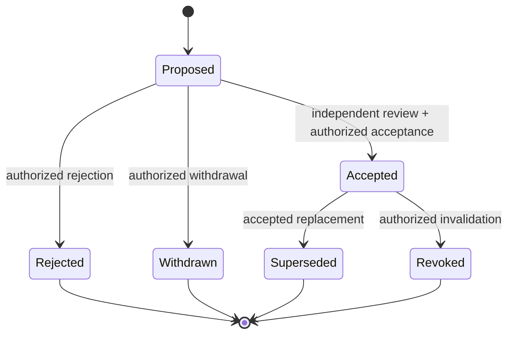

# SF CodeIntel — Detailed Technical Design Governance and Template

| Document control | Value |
|---|---|
| Document ID | SF-CI-TDD-001 |
| Revision | 0.1 |
| Date | 25 November 2026 |
| Status | Proposed — pending independent review and explicit acceptance |
| Intended repository | `sf-codeintel` |
| Intended canonical path | `docs/technical-design/SF-CI-TDD-001.md` |
| Authority domain | Authoring, completeness, review, acceptance, change control and lifecycle of phase-specific detailed technical designs |
| Design owner / acceptance authority | To be designated by project governance for each design scope |
| Implementation authorization | None granted |

> **Index broadly. Retrieve selectively. Verify precisely. Execute securely.**

This is the governance standard and reusable template for implementation-level designs. It is not `SF-CI-TDD-P1-001`, does not select a backend, and is not a coding-agent assignment. It must not be used to justify implementing speculative future infrastructure.

## 1. Purpose, authority and adoption

### 1.1 Purpose

A Detailed Technical Design (TDD) translates applicable accepted product requirements, system architecture and technical decisions into exact, implementable and testable contracts for a bounded subsystem or phase. Its purpose is to prevent implementers from inventing critical interfaces, security behavior, persistence models or lifecycle semantics while working on a task.

A TDD specifies the implementation-level **how**: responsibilities, types, interfaces, invariants, failure behavior, data ownership, state transitions, tests and operational obligations. It does not decide the product's purpose, replace the system architecture, or grant permission to execute work. It can be short for a small coherent slice and more detailed for a security-sensitive or stateful subsystem. Completeness, not document size, is the criterion.

MUST and MUST NOT describe proposed governance obligations upon acceptance of this document. SHOULD denotes a recommended default; record material departures with rationale. Examples, templates and candidate values are not accepted implementation contracts.

### 1.2 Scoped authority

| Artifact | Owns | TDD relationship |
|---|---|---|
| SF-CI-PRD-001 | Product intent, scope, requirements and product acceptance | Realize applicable CI-R and PA identifiers; do not redefine them |
| SF-CI-SPEC-001 | System architecture, technical invariants, component boundaries, technical gates and phase dependencies | Refine the applicable sections without weakening constraints |
| SF-CI-ADR-001 | ADR governance | Follow its rules when a material technical decision is required |
| Individual accepted ADRs | Specific scoped technical decisions | Implement accepted choices; unresolved material choices block affected design acceptance |
| SF-CI-TDD-001 (this document) | Detailed design governance and template | Sets completeness and review requirements; does not own concrete subsystem design |
| Accepted phase TDD / designated subordinate contracts | Exact implementation contracts and phase-specific test assertions | Own the named contracts within the approved scope |
| SF-CI-P0-001 and later bounded assignments / admission records | Execution permission, limits, deliverables and STOP conditions | A TDD cannot widen authorization, and an assignment cannot waive a design or security invariant |
| Verification evidence and independent review | Observed results, review findings and recommendations | Establish whether contracts have been demonstrated; do not create new requirements |

Authority is scoped, not a universal hierarchy by file type or revision number. All applicable accepted constraints must hold. A conflict MUST be recorded with exact revision and clause references, the affected work stopped, and an accepted clarification obtained from the owning authority. Unaffected authorized work may continue if safely separable. Do not choose the newest file, highest search rank or most convenient interpretation. Missing permission is not permission.

The TDD may designate a separate versioned technical contract (for example, a protocol schema or lifecycle table) as the single authoritative definition for that subject. It MUST identify its exact revision or immutable content reference, owner, applicability and change procedure. Do not maintain independently editable copies of the same normative schema in several documents. Generated examples are explanatory unless explicitly designated and accepted as contract artifacts.

### 1.3 Adoption and present status

The separated PRD v0.1 and architecture v0.3 remain proposed and must be explicitly accepted together before replacing the reviewed combined v0.2.1 architecture. The P0 qualification v0.2.1 remains applicable until separately superseded by v0.3 or another accepted revision. ADR governance v0.1 and backend selection ADR-001 v0.1 are also proposed. No acceptance is inferred from downloads, filenames, hashes or review of a predecessor.

P0-A is approved in principle subject to admission; P0-B is separately authorized and optional; P1–P7 are not authorized. ADR-001 remains pre-qualification with no selected backend. A P0-A report may recommend rejection or further qualification rather than P1. This document does not amend those conditions. It introduces a proposed documentation standard, not a workflow engine, registry service or new infrastructure project.

## 2. Design granularity, ownership and readiness

### 2.1 When to create a TDD

Create a phase TDD before implementing a coherent product slice with new or changed public/internal contracts, data ownership, state transitions, security boundaries or material integration obligations. Split a large phase only where independently reviewable scopes and stable dependency boundaries exist. Small changes within an accepted design may proceed under a bounded assignment without a new TDD if they do not alter the governing contract. Record why the existing contract suffices.

Do not write a full speculative TDD for every phase at project inception. Create the design when prerequisite evidence and technical decisions are available. A draft may record unknowns and candidate options, but MUST NOT present them as settled. A material decision requiring an ADR follows SF-CI-ADR-001; a TDD must not become a substitute for ADR review.

### 2.2 Identity and responsibility

Use `SF-CI-TDD-P<phase>-<sequence>` (example: `SF-CI-TDD-P1-001`) as a proposed naming convention. Record revision, scope, accountable author, designated design owner, independent reviewer, authorized acceptance authority, applicable baseline and explicit predecessor/replacement if any. These are document identities, not runtime symbol IDs.

| Role | Responsibility | Restriction |
|---|---|---|
| Design author | Elaborate contracts, identify unknowns, trace requirements and specify tests | Cannot self-approve |
| Design owner | Maintain coherent scope, dependencies and change impacts | Cannot waive higher-level constraints |
| Independent reviewer | Challenge correctness, omissions, failure paths, security and traceability | Review recommendation is not execution permission |
| Acceptance authority | Accept or reject exact revision for defined scope | Must be designated; cannot silently expand other authorities |
| Execution authorizer | Admit bounded implementation/verification work | Design acceptance alone is insufficient |
| Implementer | Follow exact accepted contracts and assignment limits | Escalate contract gaps; do not redesign material behavior ad hoc |

Roles may be held by the same authorized human where project governance permits, except that the author/implementer MUST NOT supply their own independent acceptance review. No approval identity is assigned by this template.

### 2.3 Readiness and unresolved decisions

Before submitting a TDD for acceptance, establish applicable accepted requirements and architecture; accepted decisions for material dependencies; relevant qualification evidence; compatible interface versions; an explicit in/out-of-scope boundary; and a verification strategy that can exercise the promised behavior. Identify prerequisite artifacts by exact revision, commit or digest as applicable.

Unknowns must be categorized as blocking, deferred outside the current design, or a bounded implementation choice. A bounded choice specifies allowed alternatives, invariants and who may decide; it may not transfer a security or correctness decision to a coding agent without adequate constraints. Any unresolved prerequisite that changes a contract, safety guarantee, dependency selection or required acceptance test blocks acceptance of the affected slice. Narrow the slice explicitly if it can remain useful and safe independently.

No later-phase feature may enter an earlier design merely because it appears in the architecture. No design acceptance automatically authorizes a phase, dependency acquisition, compilation of a target project, model expenditure, access to a private repository, release or deployment.

## 3. Required design content

Every TDD MUST cover the categories below where applicable. Mark genuinely inapplicable items `N/A` with a reason; do not hide missing obligations behind a generic N/A. Separate exact normative contracts from examples, assumptions and optional implementation notes. Avoid giant untyped maps where explicit structs or versioned schemas are required by the selected design.

| Area | Required implementation-level detail |
|---|---|
| Scope and traceability | Exact capability slice, CI-R/PA references, architecture clauses, applicable ADRs, non-goals, dependency gates |
| Components | Responsibility, public/internal boundary, allowed dependency direction, ownership, processes and external interactions |
| Interfaces | Version, inputs/outputs, types, validation, limits, authentication/authorization, errors, cancellation, side effects and compatibility |
| Data and storage | Identity, schema, constraints, indices, ownership, transaction boundaries, migrations, retention and cleanup; justify duplication |
| Evidence and consistency | Manifest/generation binding, provenance, coverage, resolution, freshness checks, immutable review inputs and failure modes |
| Domain lifecycles | Initial states, transitions, guards, effects, terminals, retry/concurrency semantics and recovery |
| Security | Trust assumptions, OS boundaries, allowed access/execution, threat-control-test mapping, safe logs, revocation and cleanup |
| Algorithms and budgets | Deterministic behavior, ordering, bounds, mandatory evidence handling, explicit partial results, resource measurements |
| Operational design | Install/remove/upgrade/rebuild, configuration, observability, resource ceilings, fault handling and support responsibilities |
| Verification | Exact fixtures and assertions, negative paths, traceability, benchmark protocol, gate decisions and known gaps |
| Delivery | Small independently reviewable work packages, dependencies, migration/rollback where relevant, STOP conditions in separate assignments |

A design should include enough pseudocode, sequence diagrams, state tables or precise prose to remove consequential ambiguity. Do not prescribe every helper function or incidental internal choice. Prefer minimal module surfaces and existing qualified functionality over speculative abstractions. Dependencies and source-controlled APIs must be verified against the selected versions; do not upgrade target applications to simplify extraction.

### 3.1 Component and interface contract

For each component, specify owner, responsibility, dependencies, lifecycle if meaningful, inputs and outputs, trust boundary, synchronous/asynchronous behavior and failure propagation. Distinguish an Elixir behaviour or struct contract from an external protocol or database schema. A candidate backend's internal schema does not become a public CodeIntel contract by accident.

For each externally observable operation, define:

- Stable operation identity and interface/schema version; CLI and MCP rendering where applicable.
- Exact request fields, types, optionality, defaults, allowed values, length/range limits and rejected combinations.
- Trusted context obtained outside caller input (for example, authorized workspace identity), scope validation and permission checks.
- Response fields, types, ordering, status/coverage/freshness/truncation semantics and provenance references.
- Error taxonomy: triggering condition, safe public detail, retryability, partial-result rules, transport/exit-code mapping and cleanup responsibility.
- Side effects, idempotency, concurrency, cancellation and timeout semantics; specify explicitly if read-only.
- Version compatibility and unsupported client/backend behavior; migration or replacement policy if relevant.

Example payloads MUST validate against the designated schema, but are not substitutes for it. For MCP, design only the exposed operations in the approved slice; the architecture §09 proposes context/inspect/status first, not mandatory exposure of every upstream tool. Exact MCP library, CLI exit codes and protocol shapes are to be finalized in applicable TDDs, not in this governance document.

### 3.2 Data, provenance and consistency

If the slice stores or references data, identify the logical owner and physical representation separately. Specify keys, uniqueness, foreign/reference integrity, access scope, transactional invariants, indexes for required workloads, capacity limits, lifecycle, cleanup, version compatibility and rebuild procedures. Justify each duplicated index or cache using qualification or measurement; do not introduce a second generic structural owner by default. A thin design may reference an immutable qualified backend export instead of importing all generic symbols and edges.

Where evidence is returned, explicitly design the binding to authorized workspace, input manifest, immutable generation, source span/hash, extractor/backend identity and applicable coverage. Keep declared, compiler-observed, inferred, dynamic, unresolved and runtime-observed evidence distinguishable. Test associations are not proof of verification. Preserve the architecture's distinction between snapshot integrity and `matched_at_check`, `changed_since_check`, or `unknown` live freshness. Define the observed scope, method and time; do not imply freshness at delivery or use. Strict review requires exact immutable candidate/base revisions and matching CI.

Specify stale input, missing source, partial parsing, invalidation, publication fencing, concurrent mutation, rename/delete and recovery semantics where relevant. An immutable captured manifest may represent captured bytes rather than an atomic live filesystem view. No success claim may imply consistency beyond what the selected capture and backend mechanisms establish. See architecture §§06–07 and CI-R03/04/07/13.

### 3.3 Security and operational boundaries

Security and evidence integrity apply from the first applicable prototype. The TDD MUST distinguish trusted orchestration from untrusted project source, parser/backend output and repository instructions. State the actual containment mechanism, OS identities, filesystem/network/environment permissions, limits and ownership of backend state; output filtering alone is insufficient. Where the mechanism is not yet qualified, label the dependency blocking rather than asserting an isolation guarantee.

For each threat or security invariant specify preventive control, enforcement point, denial behavior, negative test, expected evidence and responsible component. Include path/symlink escape, cross-worktree leakage, arbitrary execution, malicious or oversized artifacts, parser resource exhaustion (including VM atom lifetime where relevant), stale/forged provenance and worker termination. Select only threats and controls relevant to the phase; defer later Factory lease ordering or runtime authority registry details to their owning phases, not the foundational controls.

The read-only agent interface cannot acquire target-execution, unrestricted path or mutation authority by proxying upstream tools. Static analysis must not start/evaluate the target. Compiled enrichment, if separately admitted in its phase, requires a version-matched isolated environment and independently established provenance; worker-supplied metadata is not inherently trustworthy. Define safe logging and diagnostics, no secrets in agent-visible output, and cleanup verification. Reference architecture §§05A, 11–14 and applicable security ADRs.

## 4. Lifecycle and concurrency specification

Every domain concept with a meaningful lifecycle MUST have explicit states, permitted transitions, guards, side effects and terminal semantics. Apply this to actual operational concepts in the slice, not every transient function call or index row. Routine local read-only requests need not gain a durable workflow database. If a concept is purely transient, describe its in-memory/request lifecycle and cleanup obligations where material.

For each lifecycle define:

| Required property | What the design establishes |
|---|---|
| Identity and owner | Instance/revision/attempt identity, component with authority to transition |
| State model | Initial state, all allowed states and terminal states, independent properties such as freshness |
| Transitions | Trigger, source state, destination, guard, authorized actor and invalid-transition result |
| Effects | Persistent writes, emitted events, process actions, external effects and their ordering |
| Atomicity | Transaction boundary, fencing/compare-and-set or other qualified mechanism, concurrency invariants |
| Failure and recovery | Crash before/after commit, partial effects, cancellation, timeout and reconciliation |
| Retry and idempotency | Duplicate requests, retry identity, replay, compensation and terminal non-resurrection |
| Verification | Positive/negative transitions, competing requests, failure injection and evidence |

Use a state transition table as the authoritative form; a diagram can supplement it. For external effects that cannot be atomic with persistence, state the ordering, durable evidence, retry/compensation and residual risk. Never claim exactly-once behavior without a mechanism and supporting evidence. Define how a cancelled or failed operation releases resources and how incomplete cleanup is detected. A terminal attempt does not silently reset: retry creates a new attempt where the architecture requires it.

Where the architecture has already established a lifecycle, refine rather than replace it. Examples: §11 workspace/access; §11A build/snapshot; §11B compiled extraction/context delivery. Snapshot publication state is separate from freshness. Accepted document lifecycle (§6 below) is separate from runtime authority revision semantics; the terminology issue noted in SF-CI-ADR-001 remains deferred to P3. No change to that runtime model is made here.

## 5. Verification, performance and acceptance traceability

### 5.1 Requirements-to-tests contract

Every applicable normative requirement, invariant, material decision and phase-specific contract MUST map to one or more planned verification obligations or a clearly justified deferred/not-applicable status. Use identifiers from the accepted authorities without renumbering them. Give local contract and test IDs unique within the TDD. An illustrative mapping format:

| Contract ID | Governing authority / clause | Expected behavior | Test / evidence ID | Phase gate / status |
|---|---|---|---|---|
| `<local ID>` | `<exact CI-R, PA, architecture, ADR reference>` | `<assertion including negative case>` | `<fixture, command, artifact>` | `<applicable gate; NOT RUN>` |

Define fixture inputs, expected outputs or observable properties, test environment, exact command where selected, failure assertions, cleanup and raw evidence locations. Freeze scoring and expected results before confirmatory testing; independently review expectations. A passing associated test does not establish every invariant. Distinguish `references_test_target`, `associated_test`, `verifies_requirement`, `observed_execution` and `passed_in_run` as in architecture §06. Record the tested revision and environment. Do not omit negative authorization, lifecycle or integrity tests to reduce token consumption or implementation time.

### 5.2 Phase versus release acceptance

Reference the architecture §15A G1–G14 and PRD §§12–13 PA-01–PA-14. The TDD identifies which checks are applicable to its slice, which are exploratory, which are release requirements and which are deferred, with reason and owning phase. It MUST NOT invent a competing product or qualification scoring system, weaken accepted gates or present unratified targets as achieved. P0's own frozen fixture expectations, limits and scoring remain exclusively governed by the applicable SF-CI-P0-001 and admission record.

For measured retrieval and agent value, specify comparable baseline, exact tools/versions, permitted data, workload, client rendering and token accounting, latency including materialization/freshness checks, resource usage, quality rubric and independent review. Include guidance-only baseline where relevant. Report uncertainty, recall and abstention alongside precision; a small pilot is exploratory, not proof of non-inferiority. Confirmatory testing requires pre-ratified methodology, cost allocation, quality margin, sample plan and critical failure criteria. Inconclusive is not a confirmatory pass. The economic objective remains cost per independently accepted task, not merely tokens saved.

Operational targets in the architecture are proposed until ratified. Measure cold/warm and incremental paths separately where relevant; separate compilation from static retrieval. Bound work, token, memory, CPU, disk, subprocess and cleanup behavior with concrete values appropriate to the selected environment and assignment. Document actual measurements and residual risks, not just intended targets.

### 5.3 Acceptance evidence and independent review

Design acceptance checks that the exact design is implementable, internally coherent and aligned with accepted authorities. Implementation verification checks actual code and outcomes. Product/phase acceptance checks the applicable gate evidence. These are distinct events. A design reviewer cannot certify code not yet implemented; a passing CI run cannot silently amend an accepted design.

Before any merge recommendation independently verify the exact candidate PR diff, CI for that candidate revision, all applicable approved authority references and relevant source. Report blockers, missing evidence, conflicts and unresolved coverage; do not recommend merging merely because an agent or CodeIntel reports success. A proposed TDD, accepted TDD, completed assignment or accepted ADR is not merge authority.

## 6. TDD revision lifecycle and change control

This document lifecycle follows SF-CI-PRD-001 §1.3 and the aligned ADR governance model. It governs revisions of technical designs, not runtime application state.



| Transition | Guard | Required side effect |
|---|---|---|
| Create → Proposed | Unique identity/revision, accountable author, declared scope | Register immutable submission reference, dependencies and open questions |
| Proposed → Accepted | Independent review of exact revision, authorized acceptance, applicable prerequisites established, blocking gaps/conflicts resolved, tests specified | Record acceptance event, effective scope and immutable revision; register applicable contracts and notify work owners |
| Proposed → Rejected | Authorized decision with rationale | Preserve proposal/review history, mark non-authoritative and record affected work |
| Proposed → Withdrawn | Authorized withdrawal before acceptance | Remove from active consideration, preserve history and reason |
| Accepted → Superseded | Accepted replacement explicitly identifies predecessor and affected scope, compatibility/change impacts resolved | Change applicable authority without silent overlap or gap; notify owners, reassess pending work and verification |
| Accepted → Revoked | Authorized invalidation, reason and affected scope recorded | Remove current normative eligibility, stop reliance on affected design, notify owners and request separately authorized response |

Rejected, withdrawn, superseded and revoked are terminal for that revision. Amendments create a new proposed revision; no silent editing or resurrection of accepted history. Review feedback is not a lifecycle transition. Implementation progress, test execution and deployment state are recorded separately; do not overload document status with `implemented` or `passed`.

A material deviation discovered during implementation MUST be recorded against the exact accepted contract. Stop the affected change if proceeding would violate it; propose the smallest necessary amendment or ADR, obtain independent review and acceptance, then resume only under valid assignment authority. Record unrelated issues separately without expanding the current task. Do not retroactively alter expected test outcomes to make a deficient implementation pass. If a dependency is revoked, no predecessor automatically becomes active; resolve the affected scope explicitly.

For each accepted revision, record author, review reference, exact immutable content reference, acceptance authority/event, effective scope and conditions, predecessor/replacement if any, and impacted assignments/contracts. Git plus reviewed records is sufficient initially; no software governance engine is required.

## 7. Phase planning and required design outputs

The phase sequence below is derived from architecture §16 and PRD §11. It is an index of future design topics, not work authorization or a requirement to create every file now. Each design may be split when justified by its implementation boundary.

| Phase / proposed design ID | Expected design focus | Prerequisite / boundary |
|---|---|---|
| P0-A / P0-B | Existing SF-CI-P0-001 governs qualification and optional experiment; no production TDD needed | Ratified admission; P0-B separately authorized or explicitly deferred |
| SF-CI-TDD-P1-001 | Thin scoped CLI and experimental read-only MCP; normalized evidence, source verification, compact context, two authorized repositories | P0-A evidence and independent gate decision; accepted relevant backend/ownership ADR; separate P1 authorization |
| SF-CI-TDD-P2-001 | Ash action-centred static intelligence, action contracts, policies, changes, validations, lifecycle coverage | P1 exit; explicit support matrix; separately authorized compiled experiment if needed |
| SF-CI-TDD-P3-001 | Phoenix/LiveView links, mandatory authority and test associations, guidance integration | P2 exit; resolve CI-F16/F17; runtime authority terminology clarification |
| SF-CI-TDD-P4-001 | Version-matched compiled metadata bridge, fingerprints and isolation | P3 exit and approved execution/compatibility design |
| SF-CI-TDD-P5-001 | Factory grants/worktrees, persistent supervision, publication, retention and recovery | P4 exit; verify actual sf-security/sf-exec contracts; resolve CI-F19 |
| SF-CI-TDD-P6-001 | Immutable base/head review, impact and verification obligations | P5 exit; exact revision/CI/authority binding |
| SF-CI-TDD-P7-001 (only if needed) | Measured advanced retrieval, overlays or caching | Measured gap and separately accepted optimization decision; otherwise omit |

CI-F18 (useful coverage and abstention) belongs in P1/P2; CI-F20 (materialization/freshness overhead) in P0/P1 measurements; CI-F21 (comparable workloads and cost allocation) before confirmatory economic gates. These are inherited deferred findings, not new implementation scope. Do not defer foundational security to P5 or make optional P0-B mandatory for P0-A completion.

### 7.1 P1 design readiness — currently blocked

`SF-CI-TDD-P1-001` should be finalized only after qualification has established a viable approach and relevant decisions are accepted. It needs exact qualified backend revisions, integration/ownership contracts, source-generation semantics, supported capability boundaries, containment evidence and unresolved limitations. It must define concrete CLI/MCP and evidence contracts, errors, scope, install/remove/rebuild behavior and pilot verification, while excluding the full persistent service, comprehensive framework graph, full authority registry, embeddings and later infrastructure.

No exact backend, database schema, MCP library, implementation module tree or release performance result is selected by this standard. P0-A has not run in the supplied project history, and its admission is outstanding. A rejection or partial qualification result may require a separately authorized follow-up rather than a P1 design. An approved design is still not an admitted implementation assignment.

## 8. Reusable phase TDD template

Copy this template into the applicable phase directory when the design is needed. Replace placeholders, remove unused illustrative entries and explain N/A or deferred areas. A document with unresolved material placeholders is not ready for acceptance. The template does not grant permission to create or implement a phase prematurely.

````markdown
# <Design ID> — <Bounded subsystem or phase title>

| Document control | Value |
|---|---|
| Design ID / revision | <unique ID and revision> |
| Status | Proposed |
| Phase and scope | <exact bounded scope> |
| Author / design owner | <accountable identities> |
| Independent reviewer / acceptance authority | <designated identities> |
| Applicable baseline | <exact accepted document and ADR revisions> |
| Immutable submission reference | <commit/digest in review record> |
| Predecessor / supersedes | <exact identity or none> |
| Execution authorization | None; separate assignment and admission required |

## 1. Objective, applicability and scope
- Product outcome and exact capability slice:
- Applicable CI-R and PA IDs, architecture sections and ADRs:
- In scope / out of scope:
- Prerequisite gates and qualification evidence:
- Known unsupported capabilities and assumptions:
- Blocking decisions, bounded implementation choices and deferred items:

## 2. Components and responsibilities
| Component | Owner / responsibility | Inputs/outputs | Dependencies / trust boundary | Failure propagation |
|---|---|---|---|---|
| <component> | <scope> | <contract IDs> | <allowed direction> | <behavior> |

Provide relevant component/sequence diagram or precise equivalent. Identify reused functionality, single logical owners, physical representations and reasons for any duplication.

## 3. Exact implementation contracts
| Contract ID | Owner / version | Authoritative artifact | Governing references |
|---|---|---|---|
| <ID> | <component and version> | <inline definition or exact external reference> | <requirement/ADR/architecture clause> |

For each operation specify typed input/output, validation and defaults; trusted context and authorization; ordering and budgets; side effects and concurrency; cancellation and timeout; response/error semantics; compatibility and examples. Provide Elixir specs/structs or versioned schemas where appropriate. Distinguish illustrative examples from normative declarations.

| Error code | Trigger | Safe public detail | Retryable / partial result | Transport mapping / cleanup |
|---|---|---|---|---|
| <code> | <condition> | <sanitized detail> | <rules> | <mapping> |

## 4. Data, evidence and consistency
- Identity, ownership, logical/physical model, constraints and required indexes:
- Transactions, publication and generation binding:
- Input manifests, provenance, coverage and freshness semantics:
- Invalidation, stale/partial evidence and concurrent changes:
- Storage limits, retention, migrations and rebuild:
- Explicit rationale for additional copies/caches, or none:

## 5. Lifecycles and failure recovery
For each meaningful concept: identity, owner, initial state, all states, terminal states and independent status properties.

| From | Trigger / actor | To | Guard | Side effects / ordering | Failure and recovery |
|---|---|---|---|---|---|
| <state> | <event / authority> | <state> | <conditions> | <transaction / external effects> | <invalid transition, retry, cleanup> |

Define fencing/atomicity, cancellation, competing requests, retries, idempotency, compensation and recovery. Include transient request cleanup where meaningful; do not introduce durable workflow machinery without need.

## 6. Security and operational boundaries
| Threat / invariant | Control and enforcement point | Negative test | Expected evidence / owner |
|---|---|---|---|
| <risk> | <exact mechanism> | <fixture and assertion> | <artifact> |

Specify actual OS/process/filesystem/network/environment boundaries, trusted identities, secrets handling, allowed execution, resource ceilings, revocation and cleanup as applicable. Unqualified security mechanisms are blocking assumptions, not guarantees.

## 7. Algorithms, budgets and operations
- Deterministic retrieval or processing steps and ordering:
- Limits, truncation, mandatory evidence and partial results:
- Configuration, installation, disable/uninstall and rollback/rebuild:
- Telemetry, resource accounting, operational errors and runbook:
- Version compatibility and supported environments:

## 8. Verification and acceptance
| Contract ID | Governing requirement / clause | Positive and negative assertion | Test ID / exact evidence | Applicable gate / status |
|---|---|---|---|---|
| <ID> | <exact reference> | <expected result> | <fixture, command, artifact> | <gate; NOT RUN> |

Define fixture expectations, environment and commands; fault/concurrency cases; applicable acceptance gates and deferrals; benchmark baseline, token/time/resource/cost accounting where relevant; independent review and required raw evidence. Record actual implementation results separately from design predictions.

## 9. Delivery and change management
| Work package | Exact contract scope | Dependencies | Required verification | Out-of-scope boundary |
|---|---|---|---|---|
| <slice> | <IDs> | <prerequisites> | <tests> | <explicit exclusions> |

Each executable assignment must separately establish admission, allowed operations, budget, outputs and STOP conditions. Do not authorize the next phase here. Include compatibility, migration, rollout/rollback and reevaluation obligations when applicable.

## 10. Independent review and revision record
- Blocking findings and resolution references:
- Exact reviewed revision and authority references:
- Review recommendation and independent reviewer:
- Acceptance event / authority / effective scope: None until recorded
- Impacted downstream contracts and assignments:
- Revision history and supersession links:
````

## 9. Design review checklist and repository placement

### 9.1 Review checklist

This is a design completeness checklist, not a parallel backend scorecard or an implementation acceptance gate. Record each item as satisfied, blocking, or not applicable with reason; do not treat an unchecked or missing item as passing. Review the actual contract, not just the presence of a heading.

| Check | Reviewer must establish |
|---|---|
| D1 — Scope | Bounded capability, prerequisite gates, exclusions, no unauthorized phase expansion |
| D2 — Authority | Exact applicable accepted references; no unresolved conflict or unapproved material decision |
| D3 — Ownership | Clear component responsibilities; justified reuse and storage duplication |
| D4 — Interfaces | Concrete types, limits, validation, errors and compatibility for promised behavior |
| D5 — Integrity | Evidence identity, provenance, snapshot/freshness distinctions and failure behavior |
| D6 — Lifecycle | Every applicable meaningful lifecycle has guards, side effects, terminal and recovery semantics |
| D7 — Security | Actual enforcement mechanism and negative tests; no output-only containment or implicit execution rights |
| D8 — Verification | Traceable positive/negative assertions; applicable gates and limitations identified |
| D9 — Operations | Applicable resource bounds, cleanup, install/remove/rebuild and migration/rollback defined |
| D10 — Delivery | Reviewable work packages, explicit admission boundary and no implied subsequent authorization |

Material failures block affected design acceptance. An independent reviewer may recommend acceptance of a smaller coherent scope only after the design is explicitly amended and the exact revised scope is reviewed. Design review does not certify the implementation.

### 9.2 Intended repository placement

```text
sf-codeintel/
└── docs/
    ├── product/SF-CI-PRD-001.md
    ├── architecture/SF-CI-SPEC-001.md
    ├── adr/
    │   ├── SF-CI-ADR-001.md
    │   └── ADR-001-backend-selection.md
    ├── qualification/SF-CI-P0-001.md
    ├── technical-design/
    │   ├── SF-CI-TDD-001.md
    │   └── P1/SF-CI-TDD-P1-001.md   # future, after qualification
    └── contracts/                   # only as needed by accepted designs
```

Keep canonical paths stable and version history in Git. File naming is not proof of approval. Do not create empty phase files, duplicate normative contracts, or a separate infrastructure service merely to satisfy this layout. Each phase design may designate adjacent schema/test artifacts as authoritative within its defined scope. Link them by exact revision and keep them synchronized through review.

## 10. Traceability, compatibility and revision history

The following sources were inspected for this document. The governance additions (design IDs, content checklist, role definitions, local contract/test identity convention and reusable template) are proposed organizational rules, not findings from a running system. No upstream technology research or execution was necessary for this documentation task.

| Source | Revision | Relevant provisions |
|---|---|---|
| SF-CI-PRD-001 | 0.1 proposed | §§1, 7, 11–13: authority, CI-R01–14, staged MVP, PA-01–14, outcome validation |
| SF-CI-SPEC-001 | 0.3 proposed | §§01–19: technical authority, component/consistency/security contracts, lifecycle, gates and roadmap |
| SF-CI-P0-001 | 0.3 proposed | §§0–8: qualification authority, admission, P0-A/B, scoring, STOP conditions and gate decision |
| SF-CI-ADR-001 | 0.1 proposed | §§1–10: scoped decisions, independent review, revision identity, acceptance and template |
| ADR-001 | 0.1 proposed | §§1–9: backend alternatives, evidence requirements, decision deferred, downstream P1 obligations |
| SF-CI-SPEC-001 | 0.2.1 reviewed baseline | Inherited combined architecture; remains baseline until coordinated acceptance |
| SF-CI-P0-001 | 0.2.1 reviewed baseline | Inherited qualification scope; remains applicable until separately superseded |

The accepted-document lifecycle and the runtime authority revision vocabulary differ as noted in SF-CI-ADR-001. This standard follows the document lifecycle (accepted → superseded/revoked) and leaves runtime terminology mapping to P3. It does not resolve that open implementation concern or other deferred CI-F findings by implication.

### 10.1 Source identity

SHA-256 values identify the inspected source bytes; they do not establish signatures, acceptance or execution permission.

```text
f5374a4de6e6c021334e4965c25bb0dfe4ddf5d7671bbd007412e5a497c56a30  SF-CI-PRD-001-v0.1.md
5c7f7712b86638075c280fd236b9958c2973df7979a8b273809933e38341424e  SF-CI-SPEC-001-v0.3.md
b6021234fd7bb8d16d128a758c581a4abf288208e0f0a64f171a39f3ececec85  SF-CI-P0-001-v0.3.md
ebeb0d092ef7f134feb628df5c462a264d4246f7cf4cd846d3ecb9395ed4528f  SF-CI-ADR-001-v0.1.md
708ff8f35bbe818476fd9153053413ae6fc86e592942f43c73e9e531f3d71417  ADR-001-backend-selection-v0.1.md
eec236699730173e0612bd9bfbe6d100f417119c3efe3397de2ad24905b85ced  SF-CodeIntel-Specification-v0.2.1.md
b35b92081956fffc7f50ef973afa9591da3e5aef291254af82f12f9db9c2a2ce  SF-CodeIntel-P0-Qualification-v0.2.1.md
```

### 10.2 Revision record

| Revision | Change | Status |
|---|---|---|
| 0.1 | Initial standalone TDD governance, scoped authority, lifecycle, design acceptance checklist and reusable phase design template | Proposed; independent review and acceptance outstanding |

No concrete P1 contracts have been accepted. No qualification has been executed. No repository, source baseline, backend selection or execution authorization has been modified. The next implementation-relevant design depends on admitted P0-A execution, independently reviewed evidence, and the resulting technical decision. Do not continue generating speculative phase designs in the absence of those inputs.
